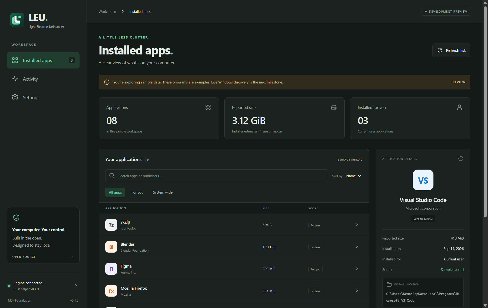

# LEU Light Electron Uninstaller

<picture>
  <source media="(prefers-color-scheme: dark)" srcset="assets/branding/leu-logo-dark.svg">
  
</picture>

[](https://github.com/KaroqDave/LEU/actions/workflows/ci.yml)

[Documentation](#project-documents) · [Roadmap](docs/ROADMAP.md) · [Privacy](PRIVACY.md) · [MIT license](LICENSE)

The project website has been retired. Documentation, development updates, and support are maintained in this repository.

**Early development · Windows 11 x64 · No public installer yet**

LEU is an open source Windows uninstaller project with a modern Electron interface. It will help people understand their installed software, run a program's own uninstaller, and review the files and settings left behind.



_Synthetic sample capture. Normal launches now discover real Windows desktop registrations. Uninstall and cleanup remain unavailable. [Screenshot provenance and licensing](docs/images/README.md)._

The central product principle is **explain every cleanup action before making it**. A useful result tells the user what LEU found, why it belongs to the selected program, and what keeping or removing it means.

## Project status

The M1 inventory preview discovers desktop programs through the local Rust helper. It reads current-user registrations and both machine registry views, preserves each registration's provenance, and supports search, sorting, scope filters, keyboard selection, refresh, and partial source warnings. System components and update registrations are hidden by default and can be included for inspection.

Missing metadata stays unknown. Size is a partial installer estimate, and the reported date may reflect installation, repair, or update. Microsoft Store packages and unregistered portable apps are outside this preview. Icons come from each registration's `DisplayIcon` and load as rows scroll into view; apps without one keep a placeholder. Comparison against known installations in disposable Windows VMs remains an M1 follow-up. Uninstall and cleanup actions are unavailable.

Confirmed direction:

- Windows first.
- Electron for the desktop interface.
- Open source development.
- A clean interface, low background activity, and a small dependency footprint.
- More detail and control over uninstallation and leftovers.

The current build target is Windows 11 on x64.

## Run locally

Install Node.js 24 LTS, pnpm 11.25.0, Rust, and the Visual Studio C++ build tools, then run:

```powershell
pnpm install --frozen-lockfile
pnpm start
```

To build and verify a standalone app:

```powershell
pnpm check
pnpm package
pnpm smoke
pnpm smoke:inventory
```

The executable is `out/LEU-win32-x64/LEU.exe`. `pnpm make` produces a Windows zip. See [CONTRIBUTING.md](CONTRIBUTING.md) for toolchain details, helper packaging, and test commands.

For synthetic data when capturing screenshots, launch the packaged executable with `--demo-inventory`. Sample mode is labeled explicitly and is never used as a fallback when discovery fails.

## Product scope

The first useful release will show installed desktop programs with search, sorting, publisher, version, installation scope, and available size information. It will run supported vendor uninstallers, refresh the inventory afterward, and offer a read-only review of potential leftovers.

Recoverable cleanup follows once LEU can validate ownership, preserve selected files, and recover from interruptions. All cleanup selections start unchecked. Personal documents, application profiles, shared runtimes, and uncertain matches require particular care and are excluded from the initial cleanup capability.

Microsoft Store package support, batch uninstallation, installation monitoring, and advanced registry cleanup belong to later milestones. LEU will work locally without an account. Core discovery and cleanup will not depend on a cloud service.

## Architecture direction

Electron, TypeScript, and React provide the interface and application workflow. A separate Rust helper communicates through private, versioned JSON messages over stdio. The app runs with normal user permissions. Later milestones will request elevation only for specific protected operations.

Electron bundles Chromium and Node.js, so its runtime creates a baseline footprint. LEU's lightweight goal therefore focuses on startup time, idle resource use, limited dependencies, and scans that run when requested. These are targets to measure, rather than claims of native utility size. See [Electron's overview](https://www.electronjs.org/).

## Project documents

- [Architecture](docs/ARCHITECTURE.md) covers components, Windows integration, data contracts, cleanup behavior, and performance targets.
- [Development roadmap](docs/ROADMAP.md) defines milestones, dependencies, acceptance criteria, and the first implementation tasks.
- [M0 status](docs/M0.md) records the foundation implementation, verification, and baseline measurements.
- [Visual identity](docs/BRANDING.md) covers the editable logos, app icon, interface icons, and export command.
- [Contributor guide](CONTRIBUTING.md) explains setup and local checks.
- [Privacy](PRIVACY.md) describes current data handling, local storage, and safe sharing.
- [Security reporting](SECURITY.md) explains how to report vulnerabilities privately.

## Open source setup

LEU is developed at [KaroqDave/LEU](https://github.com/KaroqDave/LEU) under the [MIT license](LICENSE). Use [issues](https://github.com/KaroqDave/LEU/issues) for bugs and feature requests, and [private vulnerability reporting](https://github.com/KaroqDave/LEU/security/advisories/new) for sensitive security reports. The [Windows CI workflow](https://github.com/KaroqDave/LEU/actions/workflows/ci.yml) checks, packages, and smoke-tests the application on pushes and pull requests.

This repository currently provides source code and an unsigned development build. Signed releases and public distribution are planned for M5.
