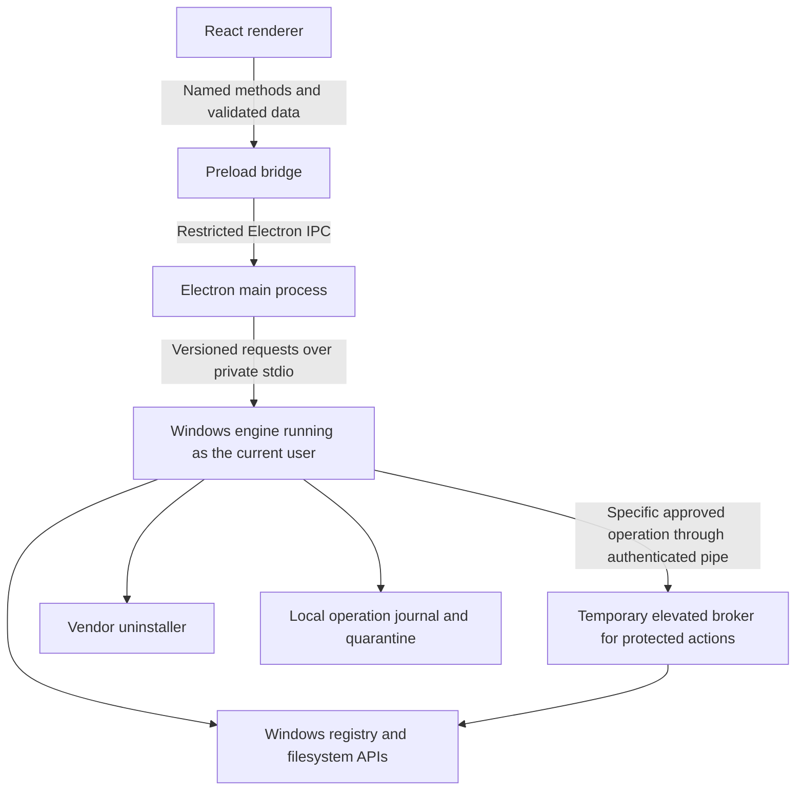

# LEU architecture

LEU will separate its interface, operation workflow, and Windows integration. The interface requests actions using program and operation identifiers; the Windows engine decides which system resources those actions may affect.

This is the proposed implementation architecture for a Windows first product. Start with Windows 11 x64 and classic desktop programs. Add other Windows architectures and package types after the initial workflow is reliable.

## Recommended technology choices

| Area | Proposed choice | Reason and tradeoff |
| --- | --- | --- |
| Desktop shell | Electron with TypeScript | Matches the product direction and provides a consistent interface. Its bundled runtime sets a substantial baseline footprint. |
| Interface | React, TypeScript, and ordinary CSS | Supports the program list, selection, progress, and review flows. Start with local state and a small set of reusable components. |
| Build and packaging | Electron Forge with its webpack TypeScript template | Gives the project one documented desktop build pipeline. Prove helper packaging in the first milestone. |
| Windows engine | Rust executable using Microsoft Windows bindings | Calls Windows APIs directly and isolates engine failures from the interface. Adds a second language and native build tools. |
| Contracts | Versioned JSON schemas and corresponding TypeScript and Rust types | Validates messages at runtime and detects incompatible app and helper versions. |
| Storage | JSON preferences initially; SQLite operation journal when mutation begins | Keeps inventory development simple, then gives operation records transactional updates. The engine owns the journal. |
| Verification | TypeScript checks, focused UI tests, Rust tests, and Windows VM integration tests | Exercises both workflow decisions and actual Windows behavior. |

Use supported stable toolchain versions at implementation time and commit JavaScript and Rust lockfiles. Ship only required runtime files. Forge documents its [first party templates](https://www.electronforge.io/); Microsoft provides [Rust bindings for Windows APIs](https://github.com/microsoft/windows-rs).

A separate executable avoids coupling the engine to Electron's native Node addon ABI. Keep its first feature small: enumerate uninstall records. Validate the extra build complexity before adding cleanup code. PowerShell may help with development fixtures, but should not become a general command execution interface in the shipped application.

## Components and trust boundaries



These are logical components. The ordinary engine and elevated broker can share Rust libraries and build from the same workspace. The broker is introduced when protected LEU operations require it; the first inventory prototype needs no elevated component.

| Component | Responsibilities |
| --- | --- |
| Renderer | Program list, details, selection, progress, accessibility, and review screens. No registry access, command construction, or filesystem mutation. |
| Preload | Expose one method per supported action. Forward validated payloads and sanitized events. Never expose raw Electron IPC. |
| Main process | Window lifecycle, trusted origins, message validation, engine lifecycle, and coordination of operation identifiers. |
| Windows engine | Inventory, identity resolution, uninstall preparation, scan rules, operation journal, and cleanup validation. |
| Elevated broker | Execute a bounded protected action after independent validation. Exit when the operation finishes. |

Load bundled interface assets through a restricted application protocol. Enable renderer sandboxing and context isolation, disable Node integration, apply a restrictive content security policy, and validate the sending window and frame for every privileged IPC request. Block unapproved navigation and new windows. These choices follow [Electron's security guidance](https://www.electronjs.org/docs/latest/tutorial/security).

The renderer cannot authorize arbitrary executable paths, registry keys, or deletion targets. A program name, icon path, registry value, or helper message is untrusted input even when it came from the local machine.

## Windows inventory

Read uninstall records from the current user's and machine's uninstall registry locations. On x64 Windows, explicitly enumerate the relevant 32 bit and 64 bit views. Keep the hive, view, and subkey as provenance; they are part of program identity. Microsoft documents the [uninstall properties](https://learn.microsoft.com/en-us/windows/win32/msi/uninstall-registry-key) and [registry view flags](https://learn.microsoft.com/en-us/windows/win32/winprog64/accessing-an-alternate-registry-view).

The M1 implementation reads `HKLM` in its x64 and x86 views and `HKCU` once with a `shared` view. `HKCU\Software` is shared on supported Windows versions, so repeating it through both view flags would duplicate the same physical registrations. See Microsoft's [shared registry keys](https://learn.microsoft.com/en-us/windows/win32/winprog64/shared-registry-keys). The `windows-sys` bindings open read-only registry handles; the provider never reads uninstall commands or resolves installation locations. Strings end at their first NUL, as Windows reads them, then use strict UTF-16 decoding with an 8 KiB read limit. Enumeration visits at most 4,096 registrations, collects at most 64 detailed warnings with an omitted count, and reserves 6 MiB of the 8 MiB response for program records. Limits, source failures, unreadable registrations, and registrations hidden by an unusable `DisplayName` return an explicit partial inventory. Malformed optional metadata produces warnings but leaves the list complete. The app allows the inventory request 60 seconds, because a missed deadline restarts the helper.

Normalize records into a common model while preserving their source. Do not merge two installations solely because their display names match. Hide system components and update registrations in the ordinary view while allowing users to inspect them without offering unsupported actions. As in Programs and Features, a registration with `ParentKeyName` or an update `ReleaseType` (update, hotfix, security update, service pack, update rollup, or critical update) is an update rather than a program.

The current provider omits registrations without a usable `DisplayName`. Absent optional metadata becomes `null`; malformed or unreadable values also produce source warnings. Registry `InstallDate` is validated as a calendar date and exposed as `reportedInstallDate`, since servicing can change it. No directory-size measurement or filesystem check is inferred from registry metadata.

| Program field | Meaning |
| --- | --- |
| `id` | Opaque identifier derived from the source record and installation scope. |
| `source` | Registry hive, view, and subkey; later, a package identity. |
| `name`, `publisher`, `version` | Display metadata with missing values allowed. |
| `scope` | Current user or machine. |
| `installLocation` | Reported location, treated as untrusted and potentially absent. |
| `reportedSizeBytes` | Optional installer estimate with its source recorded. |
| `reportedInstallDate` | Optional validated `InstallDate`, which may reflect installation, repair, or update. |
| `systemComponent` | Installer flag; hidden by default, available through the inclusion checkbox. |
| `updateRegistration` | Child update or servicing registration; hidden by default with system components. |
| `capabilities` | Whether details, supported uninstall preparation, or a particular scan is available. |

Present unknown size as unknown. Distinguish installer estimates from measured directory usage. Fetch icons lazily and avoid traversing every installation directory during startup. An inventory refresh can return partial results with explicit source errors.

Do not use `Win32_Product` for discovery. Microsoft documents that queries can trigger package consistency checks and repairs, which is inappropriate for a read-only inventory. See the [Win32_Product remarks](https://learn.microsoft.com/en-us/previous-versions/windows/desktop/msiprov/win32-product).

Treat Microsoft Store and other MSIX packages as a separate provider. A later read-only provider can use `PackageManager` for the current user; querying other users has different privilege requirements. Package removal must use the deployment APIs, with dependencies and frameworks handled separately. See [FindPackagesForUser](https://learn.microsoft.com/en-us/uwp/api/windows.management.deployment.packagemanager.findpackagesforuser).

## Operation contracts

Expose a narrow bridge such as:

```typescript
interface LeuBridge {
  listPrograms(): Promise<InventoryResult>;
  prepareUninstall(programId: string): Promise<UninstallPlan>;
  startUninstall(planId: string): Promise<OperationRef>;
  scanLeftovers(operationId: string): Promise<ScanRef>;
  prepareCleanup(scanId: string, candidateIds: string[]): Promise<CleanupPlan>;
  applyCleanup(planId: string): Promise<OperationRef>;
  restoreCleanup(operationId: string): Promise<OperationRef>;
  cancelScan(scanId: string): Promise<void>;
}
```

These are proposed signatures, not implemented APIs. Read-only milestones expose only the methods they support. Events report operation identifiers, current phases, counts, and structured errors; they do not expose Electron event objects.

Use a protocol version, request identifier, method allowlist, payload limits, deadlines, and structured success or failure responses. Newline delimited JSON over private child process pipes is sufficient for the ordinary helper. Do not open a localhost control server.

### Helper protocol

The main process owns one helper and multiplexes requests over its pipes by request identifier; responses may arrive in any order. The Rust engine is the single source of the contract. Each method is declared once in the engine's `engine_methods!` list with typed, `deny_unknown_fields` parameters, a typed result, and its handler. That list generates dispatch and the allowlist, enforcing the handler's declared return type. Request and response envelope schemas are derived from the structs used by the engine, with deserialization schemas for incoming requests and serialization schemas for outgoing responses. Behind the `schema` feature, a generator binary exports the JSON schemas, limits, and error codes, and `pnpm contracts` turns that export into `src/contracts/contract.json` and TypeScript types. The shipped helper is built without the generator. CI fails when the generated files are stale. Both sides inspect recognizable protocol versions before strict envelope validation so future envelope changes report a protocol mismatch. For compatible versions, the client validates the envelope, then the method's parameters or result. Local request validation failures use `INVALID_LOCAL_REQUEST`, distinct from engine-reported `INVALID_REQUEST` errors.

Frame limits differ by direction and include the newline. Requests carry identifiers rather than bulk data and stay at 16 KiB. Responses may reach 8 MiB so a full inventory fits in one frame; the engine replaces a larger response with `RESPONSE_TOO_LARGE` rather than truncating it. If a result could exceed that bound, page it explicitly rather than raising the limit.

An error response rejects only its request. A malformed frame, a contract violation, an unsolicited response, or a missed deadline ends the connection and rejects every pending request, because the stream can no longer be trusted. The interface then offers a reconnect.

The engine currently handles one request at a time. Before scans (M3), extend the protocol in a backward compatible way:

- **Events.** Add a third frame kind, `{ protocolVersion, event, operationId, data }`, with no `id` and no `ok`, for progress, phase changes, and partial results. Events are validated per event name, like method results, and are routed by operation identifier. The response to the starting request returns that identifier.
- **Cancellation.** Add an `operation.cancel` method that the engine answers immediately while the operation keeps running. The operation then finishes with a terminal event that reports whether it completed, was canceled, or failed. This requires reading requests on a separate thread from the work they start, with bounded concurrency.
- **Deadlines.** Long operations are not bound by a single request deadline. The starting request must respond promptly; liveness then comes from events and an inactivity timeout.

The engine creates immutable, expiring plans. A plan records the inventory snapshot, action, program identity, and relevant resource fingerprints. The interface submits a plan identifier after the user reviews it. The engine rechecks the underlying state before acting and invalidates stale plans.

## Vendor uninstallation

Support a narrow set of uninstall methods first: MSI product removal and ordinary executable uninstallers with an unambiguous executable path. Re-read the source record when preparing and launching the operation. Build MSI removal from validated product identity rather than blindly executing a registry string.

For executable uninstallers, resolve an explicit executable, preserve its supported arguments, and validate Windows quoting. Reject ambiguous commands and script or shell based uninstallers until a dedicated adapter exists. Never pass registry strings to `cmd /c`, PowerShell, or a renderer supplied shell command. Use the appropriate Windows launch APIs, including [ShellExecuteExW](https://learn.microsoft.com/en-us/windows/win32/api/shellapi/nf-shellapi-shellexecuteexw) where elevation is required.

Show the selected program and intended vendor action before launch. Keep interactive vendor uninstallers visible. Handle declined UAC, missing executables, vendor cancellation, failures, restart requirements, and launchers that hand work to another process. Terminating a vendor uninstaller is not a safe general cancellation mechanism.

Track launch, observed exit, and refreshed inventory separately. An exit code alone cannot prove removal. Report outcomes such as removed, still registered, restart required, failed, canceled, or completion unknown. Keep contradictory evidence visible and do not label a launch as successful removal.

Snapshot the available ownership evidence before starting the vendor uninstaller, since its uninstall record may disappear. Begin cleanup review only after the vendor step has finished or the user has explicitly resolved an uncertain result. LEU's recovery feature covers LEU cleanup actions; it cannot reverse arbitrary changes made by a vendor uninstaller.

## Leftover detection and review

Scope a scan to one selected program and bounded locations derived from verified evidence. The first detector should inspect specific application directories using reviewed rules and saved inventory metadata. Give every candidate its path, category, ownership evidence, estimated or measured size, and the consequence of removal.

| Evidence category | Initial treatment |
| --- | --- |
| Reviewed application rule with exclusive directory ownership and corroborating metadata | Eligible for user review and, later, recoverable cleanup. |
| Exact program or publisher name with incomplete ownership evidence | Display as uncertain; exclude from the initial cleanup capability. |
| Shared runtime, shared publisher directory, system resource, or another installed app's directory | Exclude from cleanup. |
| User documents, saves, credentials, or application profile | Exclude from initial cleanup; explain that data may remain. |

A familiar directory name or old timestamp does not establish ownership. Never delete a publisher's parent directory because one application was removed. Do not crawl whole disks or perform broad registry searches during the first release.

All selections start unchecked. The review explains whether an item is a cache, a setting, or potential personal data. Confidence describes evidence, rather than a guarantee that deleting an item has no consequences. Registry candidates can be displayed later, but registry mutation has a separate release gate.

## Cleanup and recovery

Serialize mutation operations. Before each selected action, durably record its intended change and backup location. Validate resource identity again immediately before mutation. If state changed, require a new review.

Start with application specific cache files in supported local locations. Move eligible items into a protected quarantine on the same volume where possible, preserving the metadata needed for restoration. Unsupported filesystems, network paths, insufficient space, or preservation failures leave the item untouched. Cross volume backup and deletion require a separately validated implementation.

Quarantining files does not reclaim their occupied disk space. Show quarantined bytes separately from space actually reclaimed after explicit permanent removal. Retain quarantined items until the user restores or permanently removes them in the initial release.

Check canonical paths, volume and file identities, protected roots, and every path component for reparse points. Use handle based validation where necessary to prevent a path swap between review and execution. Deny filesystem roots, Windows directories, broad Program Files or user profile roots, LEU's own files, and resources shared with installed programs. A string prefix check is insufficient. Do not take ownership of protected resources or bypass access controls to force a cleanup.

The operation journal records per item states such as planned, backup verified, change applied, restore pending, restored, skipped, and failed. After an interruption, reconcile the journal with actual filesystem state before offering recovery or resuming. SQLite commits do not make external filesystem changes transactional. Restore must detect conflicts at the original path and must never silently overwrite newer data.

Registry cleanup comes later. It needs backups that preserve value names, types, data, registry view, and any supported key metadata, plus tested conflict handling. A registry export or system restore point is not a general guarantee of complete recovery.

## Elevation design

The interface and ordinary engine run as the current user. A vendor uninstaller may request UAC independently. LEU's elevated broker is reserved for protected LEU operations and has no general run command or delete path API.

Before introducing the broker, validate the installed helper's integrity and design a private named pipe with restricted access, authenticated peers, protection against pipe precreation, and a single operation lifetime. The broker independently validates the resource identities and action against its own policy. An unprivileged plan hash binds a review to its contents; it does not by itself authorize a privileged action.

Over the shoulder UAC with another administrator account must preserve the initiating user's identity. Never derive that user's AppData locations from the elevated account's environment. Keep elevated backups and manifests in locations whose access controls prevent an ordinary process from replacing privileged restoration targets.

## Interface structure

Use three primary destinations: Installed apps, Activity, and Settings. Show the selected program's details beside the list when space allows. Make leftover review part of the selected operation so users can understand its context.

The main list provides search, publisher and scope filters, sortable size and name columns, clear unknown values, and a refresh action. Details include source, version, install location, available actions, and the evidence behind reported sizes. Avoid a decorative dashboard that delays access to the program list.

Use system light and dark preferences, keyboard navigation, visible focus, descriptive action labels, and progress text. Scans should show their current location or phase and support cancellation. Avoid invented percentage completion when the total work is unknown.

## Performance and privacy targets

These are provisional engineering targets for a release build on a Windows 11 x64 machine with an SSD, four CPU cores, and 16 GiB RAM. Confirm or adjust them after the first prototype; no performance has been measured yet.

| Measurement | Initial target |
| --- | --- |
| Cold start to searchable inventory | At most 3 seconds at the 95th percentile across 30 runs with roughly 300 installed records. |
| Idle CPU | Below 1 percent of total machine CPU averaged over 60 seconds after settling. |
| Idle memory | Aim for at most 250 MiB summed private working set across LEU processes; report shared memory separately. |
| Renderer JavaScript | Aim for at most 200 KiB compressed, excluding Electron. |
| Scan responsiveness | Visible progress and cancellation acknowledgment within 1 second; bounded outstanding work. |

Record the machine, OS, Electron version, build type, and dataset with measurements. Separate real inventory results from fixtures. Track package download size and installed footprint from the first build before setting a release size budget.

Keep expensive work in the engine, cache icons, limit concurrent directory work, and start scans on request. Do not install a background service or start with Windows by default. These choices align with [Electron's performance guidance](https://www.electronjs.org/docs/latest/tutorial/performance).

The current preview's data handling is documented in [PRIVACY.md](../PRIVACY.md). Packaged browser sessions block external network requests; development uses only the local Forge server for the interface. Production source maps are omitted, and release helper builds remap machine-specific source paths.

For future capabilities, inventory, paths, journals, and quarantine must remain local. Diagnostic exports require a user action and provide a preview with usernames and sensitive paths redacted. Network access for release checks is separate from core functionality, and update installation must verify release authenticity. New Node.js or native network APIs need their own privacy review because they bypass the browser-session request policy.

## Proposed repository layout

```text
src/
  main/                 Electron lifecycle, IPC, engine client
  preload/              Restricted renderer bridge
  renderer/             React views, styles, interaction state
  contracts/            JSON schemas, types, protocol fixtures
native/
  engine/               Rust binary and Windows adapters
  core/                 Identity, rules, plans, and journal logic
rules/                  Reviewed declarative application rules
tests/
  fixtures/             Synthetic inventories and leftover scenarios
  integration/          Disposable Windows VM cases
docs/                   Architecture, roadmap, and contributor guides
```

Create directories when their code is introduced. Keep cleanup rules declarative and bundled with reviewed releases initially; executable plugins and remotely downloaded rules would add another trust boundary.
